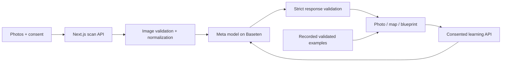

# RealityLab · Liquid Gallery

For makers preparing hands-on demonstrations: explain one visible principle from an everyday-object photograph, then test a separate craft study.

**Live:** https://realitylab.onrender.com

## Run

Node.js 24.19+:

```sh
npm ci
cp .env.example .env
# Configure BASETEN_API_KEY securely; never commit the key.
npm run dev
```

Open http://localhost:3000. Production: `npm run build` then `npm start`. Restart after changing server secrets. Render uses `BASETEN_API_KEY` as a server environment secret. The verified analysis model is `meta-models/muse-spark-open-1026` through Baseten. Optional per-component concept art uses the direct Meta image API only when `META_API_KEY` and the currently supported `META_IMAGE_MODEL` identifier are configured server-side.

The [Blueprint Studio update](docs/BLUEPRINT_STUDIO.md) adds graphite drawings, local photo/edge studies and a larger evidence workspace. Edge traces show image contrast, not recovered geometry.

The [engineering dossier update](docs/ENGINEERING_DOSSIER.md) adds generated construction stages, craft-model projects, downloadable assembly studies and tab-memory reuse. The recorded fan includes a free dossier preview.

The [Visual Atlas](docs/VISUAL_ATLAS.md) includes original generated editorial artwork, workflow icons, SVG accents and reduced-motion-aware interactions.

The [guided product showcase](docs/GUIDED_DEMO.md) provides a four-chapter recorded tour from the homepage’s “See it in action” button.

## Current experience

- Up to three normalized JPEG/PNG photos or camera captures, reviewed before explicit provider consent.
- Real Meta analysis: observed/inferred parts, evidence, approximate markers, material hypotheses, working principles and uncertainty.
- Linked inspector, filters/search, relationship map, local marker edits and conceptual SVG blueprints with themes, expansion and downloads.
- Functional diagrams and a separate app-authored LED circuit with ideal switch/current behavior.
- Consented Meta-generated paper/cardboard analogues and scan-grounded follow-up questions.
- Explicit, one-at-a-time AI component concept illustrations, labeled as explanatory images rather than source evidence or measured geometry.
- Versioned project save/restore for the investigation, with photos excluded by default and explicit embedding when requested.
- Per-request browser/server timing, provider-token provenance, and optional atomic shared hourly limits through Upstash Redis.
- Recorded real fan, bicycle, compass, furniture and mouse analyses: opening uses no new inference credits.
- Prepared procedural 3D fan, shaders, reduced-motion handling and static WebGL fallback.

This is an explanation and learning prototype. It does not recover hidden wiring, reconstruct arbitrary objects into CAD, measure dimensions, verify materials or diagnose faults. The 3D fan is handcrafted. Blueprints are conceptual and not to scale. Errors never substitute a recorded result.

## Data flow



No photos or questions are persisted automatically by this app. Users can explicitly download a local project file; photos are excluded unless they opt to embed them. Provider policies still apply. Other browser drafts/edits live in memory. Inference has restartable process limits and optional shared Redis enforcement; neither establishes a dollar cap. Use a verified shared store and provider billing controls before broad exposure.

See the [full website audit and fixes](docs/FULL_AUDIT.md) for verified coverage and remaining limitations.

See the [mobile and output resilience follow-up](docs/RESILIENCE_AUDIT.md) for offline behavior, phone navigation and long-label improvements.

## Checks

```sh
npm run build
npm run typecheck
npm test
npm start
# Another terminal; Chromium required, optionally set CHROMIUM_PATH:
npm run test:browser
npm run test:capture
npm run test:server-envelope
npm run test:exploration
npm run test:blueprint
npm run test:learn-ui
npm run test:demos
npm run test:audit
npm run test:resilience
npm run test:theater
npm run test:recovery
```

Browser suites use fixtures and make no paid calls. GitHub Actions checks without secrets. The opt-in `node --use-env-proxy --use-system-ca scripts/curate-demos.mjs --live` makes three paid scans without automatic retry and overwrites saved examples. They do not need regeneration for normal use.

## Deploy and present

`render.yaml` builds and deploys branch `codex/realitylab-live-explorer` with `npm ci --include=dev && npm run build`, `npm start`, and `/api/health`. The minimal `frontend/package.json` supports the previous Render build command; there is no separate frontend app. Health `liveVerified` tracks a successful scan in the current process only.

See [release audit](docs/RELEASE_AUDIT.md), [evaluation](docs/EVALUATION.md), [three-minute demo plan](docs/DEMO_SCRIPT.md) and [submission draft](docs/SUBMISSION.md). Physical mobile tests and the narrated final video remain human tasks.

## Attribution

Existing MIT license retained; see LICENSE. Geist uses its bundled SIL Open Font License. Dependencies retain their respective licenses. Fan geometry, shaders and SVG templates are original app code. CC0 photos: fan — Crawdad Blues; bicycle — Shams948; compass — Aaron Burden / Unsplash; furniture — Kullatan Kin; mouse — Raysonho / Open Grid Scheduler. [Exact source pages and license metadata](public/demos/sources.json) are also linked in results. No external 3D reconstruction code or assets are included.

The current fresh implementation was built during the hackathon on October 28, 2026. Earlier Git history remains; identify the new features and commits in the demo.

## Phase details

## Phase 2 · Photo capture

The capture flow now validates file signatures, size (5 MB), pixel count (20 MP), corrupt images and animated PNGs. JPEG/PNG images are orientation-normalized, resized to a maximum 1600-pixel edge, re-encoded as JPEG to strip source metadata, and previewed locally. Transparent areas become white. Normalization can alter compression and color; it is not archival storage. Up to three views can be reviewed, reordered by making a main view, removed, or cleared. Consent resets when the photo set changes. Drafts survive in-app navigation but not refresh/close; there is no browser-storage persistence.

Camera capture uses a native accessible dialog with live preview, review, retake, explicit Use photo, device switching when multiple cameras are reported, and readable permission/device/busy/timeout recovery. Tracks stop during review, on close/navigation, and when the tab is hidden. A native device-camera picker is available on mobile. Browser/device support varies; choosing files is always available.

`npm run test:capture` exercises the normalization, validation, mixed uploads, capacity, consent, draft lifecycle, camera review/retake/use, permission denial/retry and accessibility with Chromium's simulated camera. This does not replace testing actual iOS/Android hardware. Phase 3 now enables consented live analysis; the capture tests intercept scan requests to avoid charges.

`npm run test:devices` adds fixture-only Chromium checks for emulated phone layouts, coarse-pointer target sizes, keyboard entry, forced colors, reduced motion and missing-camera recovery. The [Phase 7 device matrix](docs/PHASE7_DEVICE_MATRIX.md) keeps these automated results separate from physical iOS/Android, low-power GPU and human assistive-technology checks.

## Phase 3 · Live Meta analysis

Configure `BASETEN_API_KEY` securely on the server, then restart. The app uses the verified Baseten hackathon model `meta-models/muse-spark-open-1026`. The React app, Next.js API routes and public Render service share the same origin. No separate Python service is needed.

Upload photos, optionally describe your focus, confirm provider consent, and press Analyze. The API validates images and model JSON; results show your photos, component evidence, hypotheses, principles, uncertainty, latency and provider/model provenance. Errors preserve inputs without substituting a sample.

See [Phase 3 engineering and validation](docs/PHASE3.md). Additional checks: `npm run test:api`, `npm run test:live-ui`. Normal tests use fixtures; the opt-in validation script incurs credits.

## Phase 4 · Component exploration

Live results include a keyboard-accessible relationship map, synchronized component/photo/working-principle selection, observed/inferred filtering and search. Model associations remain explicitly unverified. Photo markers can be corrected locally without overwriting the original analysis; export labels these corrections separately. Exploration does not make additional inference calls.

See [Phase 4 behavior and evidence boundaries](docs/PHASE4.md). Checks: `npm run test:unit` and `npm run test:exploration`.

## Phase 5 · Conceptual blueprints

Live results now include photo-positioned SVG callouts in classic-blue and paper styles, source-view selection, zoom, linked component selection and portable download. Inferred and unlocated components stay separate; **not to scale** remains visible. Current filters and local marker adjustments carry into the diagram. It is a symbolic educational schematic, not reconstructed geometry.

Exports exclude photos by default. You may explicitly embed the prepared source photo in the SVG you download. No additional AI request is needed. See [Phase 5 semantics, privacy and validation](docs/PHASE5.md). Checks: `npm run test:unit` and `npm run test:blueprint`.

## Build & Learn and diagram lab

Generate a separate Meta-guided paper/cardboard analogue or ask a question scoped to a scan. Guidance includes materials, observations, estimated time, limitations and local progress. The real object stays untouched; learning requests share the existing provider budget limits and require explicit consent.

The diagram lab adds a source-grounded functional sheet and a separately labeled illustrative LED circuit with a working switch simulation and ideal-current calculation. These do not recover hidden wiring from photographs. Both export SVG. Blueprints gain an expanded drawing view and refined presentation.

See [engineering dossier behavior and validation](docs/ENGINEERING_DOSSIER.md). Checks: `npm run test:learning`, `npm run test:learn-ui`, `npm run test:server-envelope`.

### Phase 6 measured usage controls

[Timing and shared-quota design](docs/PHASE6.md). New responses separate request-read, normalization, quota and provider time while the browser records its complete wait. Optional Upstash enforcement is implemented but is not active until the shared store is configured and tested; the current public service must not be described as having a durable or dollar cap.

### Project brief and review

[Project brief & evidence](https://realitylab.onrender.com/project) · [Shareable recorded tour](https://realitylab.onrender.com/?demo=1). The brief links five real response records, exact-model integration, limitations and original-work notes. See [judge readiness](docs/JUDGING_READINESS.md) for remaining physical/user validation and submission tasks. Run `npm run test:project` for brief metrics, responsive/accessibility checks and app handoffs.

### Honest audit and observation journal

[Product audit](docs/HONEST_AUDIT.md) prioritizes evidence gaps over cosmetic changes. Build & Learn now separates completion from actual user-reported outcomes: expand a step’s “Record your test result,” compare expected versus actual, and export the journal with the dossier. Records are tab-memory only and are not independently verified. Uncertain identifications surface a suggested next view and edit-photo action without automatic inference.

### Phased remediation

[Ordered phases and all 32 audit mappings](docs/REMEDIATION_PHASES.md). Phase 1 aligns the home, capture and project brief around one maker-demonstration task. [Pilot protocol](docs/research/PHASE_1_PROTOCOL.md) and the empty participant template define future validation; no user outcomes have been measured.

### Phase 2 evaluation

[Evaluation workflow and limits](evaluation/README.md): `npm run eval:recorded` and `npm run eval:plan` run offline; paid calls require explicit live mode and a 1–4 request limit. The suite retains the known screwdriver failure, separates controlled transforms from held-out objects, and binds actual human reviews to input/result hashes. No recognition accuracy is inferred from valid JSON.

### Phase 3 physical-trial preparation

[Separate cardboard support study](https://realitylab.onrender.com/trial/stability) and [protocol](docs/physical-trials/STABILITY_PROTOCOL.md). The page provides an app-authored, untested procedure and an entirely blank worksheet, with partial/failure exports and no AI requests. It never marks reports independently verified. Physical trial and user evidence remain missing; `docs/physical-trials/results.json` is intentionally empty.

### Phase 4 observation reasoning

[Workflow and evidence limits](docs/OBSERVATION_REASONING.md). A practical-step journal can draft a question with its full report attached; inspect/update it, consent and explicitly ask Meta for possible explanations and distinguishing observations. Drafting makes no request. Replies and exports preserve the report snapshot and never mark it independently verified.
