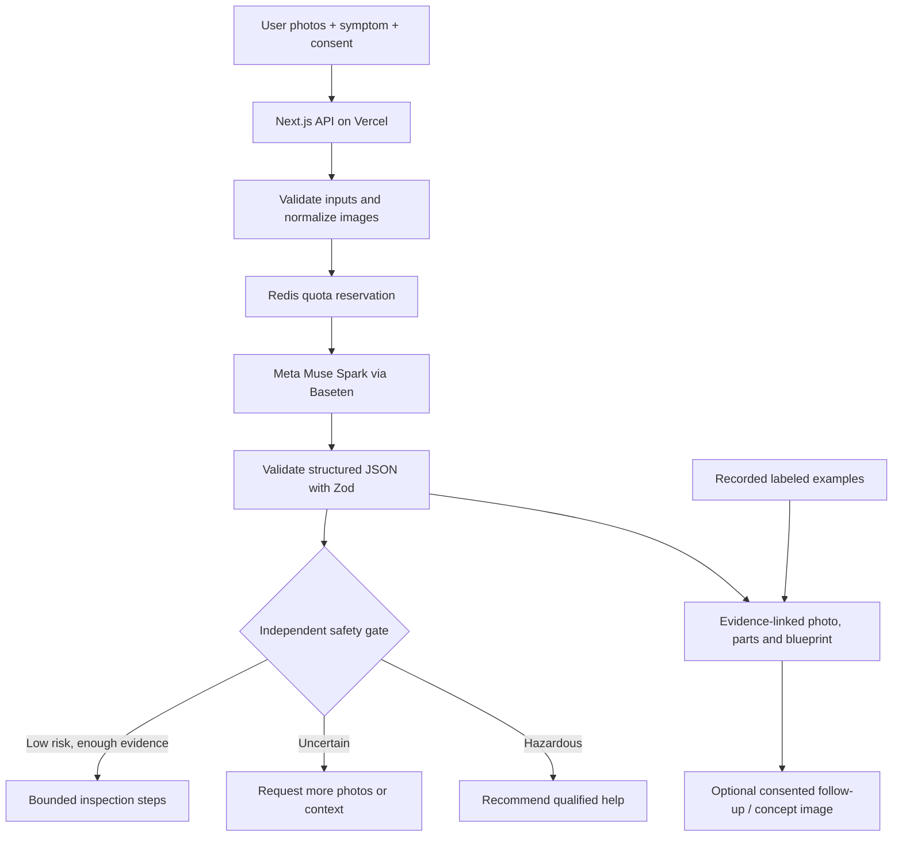

# RealityLab AI
### See the problem. Understand the evidence. Take the next safe step.

**RealityLab** is an AI-powered visual investigation and cautious repair-guidance prototype. Upload a photo of an everyday physical object, describe what seems wrong, and explore an evidence-linked analysis: visible parts, possible causes, risk flags, and—only when appropriate—up to three bounded inspection steps. When the image is insufficient or the case is hazardous, RealityLab asks for more evidence or recommends qualified help instead of inventing instructions.

Built for the **Meta Global AI Developer Hackathon 2026** — **Indie Developer** track · **Build for Your World** theme.

[**Watch the final demo video**](https://drive.google.com/file/d/1jgVVoAhj1mMxrH_i_uhe8pl4if4mOCLC/view?usp=drivesdk) · [**Launch live app**](https://realitylab-fix-anything.vercel.app) · [**Open project brief**](https://realitylab-fix-anything.vercel.app/project) · [**Explore recorded demo**](https://realitylab-fix-anything.vercel.app/?demo=1) · [**Judge's guide**](docs/JUDGE_GUIDE.md) · [**Architecture**](docs/ARCHITECTURE.md)

> **Final demo video:** [Watch on Google Drive](https://drive.google.com/file/d/1jgVVoAhj1mMxrH_i_uhe8pl4if4mOCLC/view?usp=drivesdk). The creator uploaded an MP4; confirm that anyone with the link can view it without signing in before submitting.

---

## The problem

Everyday objects break, behave unexpectedly, or are difficult to understand. A photograph is useful evidence, but generic vision descriptions often blur **what the camera actually shows**, **what the model merely infers**, and **what is safe to try**.

RealityLab turns the photo into an inspectable investigation rather than an authoritative diagnosis. The intended user can trace a suggested part back to its source image, explore a conceptual blueprint, and decide whether additional evidence or professional assistance is needed.

## What you can do

| Experience | What it really does |
| --- | --- |
| **Capture & describe** | Review up to three JPEG/PNG photos or camera captures and add a symptom, model/context, or investigation goal. Explicit consent precedes provider requests. |
| **AI visual analysis** | Meta Muse Spark vision/reasoning via Baseten returns model-proposed components, visible evidence, unobserved hypotheses, principles, uncertainty and possible causes. |
| **Safety-gated triage** | A separate deterministic safety gate can withhold instructions for hazardous objects/actions, high risk, or insufficient evidence. |
| **Guided inspection** | Low-risk, identified cases can show up to three steps with a purpose, tools, observable checkpoint, common mistake and stop condition. Feedback can prompt a reassessment. |
| **Explore the evidence** | Select photo-linked part markers; filter observed vs inferred parts; inspect a relationship map; adjust markers locally without modifying the model output. |
| **Blueprint & learning** | Export conceptual—not measured—blueprints and request a separate consented paper/cardboard learning study. |
| **Optional AI visuals** | Generate conceptual component or repair-step illustrations only on request, using the configured Meta image API. Illustrations are not source evidence. |
| **Save or revisit** | Browse clearly labeled recorded model runs without new inference; download a local investigation/project file with photo inclusion optional. |

### Try it in under two minutes

1. Open the [live application](https://realitylab-fix-anything.vercel.app). To avoid consuming credits, start with **See it in action** or another clearly labeled recorded analysis.
2. Follow an observed component from **source photo → part inspector → conceptual blueprint**. Compare it with an inferred component that has no claimed photograph marker.
3. Open the repair report. Read **possible cause**, **risk**, **check first**, and the step-by-step path if permitted; otherwise follow the request for more evidence or professional referral.
4. If the public hourly quota has capacity, choose **Scan your own object**, upload an image, provide consent, and analyze. A live request consumes model capacity and can take longer than a recorded demo.

For a guided 2–3 minute walkthrough and what each screen proves, see [docs/JUDGE_GUIDE.md](docs/JUDGE_GUIDE.md).

## How RealityLab works



- **Main model path:** `meta-models/muse-spark-open-1026` using Baseten's inference API. One model invocation per initial scan; separate requests for optional activities are always opt-in.
- **Image-generation path:** optional configured Meta image model; returned images are explicitly conceptual.
- **Host:** Vercel serves both the Next.js UI and Node.js API routes. No continuously running Python server is required.
- **Shared quota:** Upstash Redis REST controls aggregate hourly reservations. The deployed demo currently has a conservative shared quota; a rate-limit error does not mean the site is offline.
- **User experience:** staged progress events stream over NDJSON. Model responses and cross-references are schema-checked before display; model failures never silently substitute recorded sample results.
- **Visualization:** React + Three.js for the prepared showcase, plus controlled browser-rendered diagrams and mobile/reduced-motion fallbacks.

Read the [technical architecture](docs/ARCHITECTURE.md), [orchestration detail](docs/FIXCORE_ORCHESTRATION.md), and [evaluation notes](docs/EVALUATION.md).

## Tech stack

**Next.js 16**, **React 19**, **TypeScript**, **Node.js**, **Sharp**, **Zod**, **Three.js**, **Lucide**, **Vercel**, **Upstash Redis**, **Baseten inference**, and the **Meta AI image API** (optional).

**Not implemented:** universal physical repair verification, automatic photo-to-CAD reconstruction, or a working SAM 3.1 segmentation stage. SAM is a potential extension, **not** part of the shipped inference path.

## Run locally

Requirements: **Node.js 24.19+** and npm.

```bash
git clone https://github.com/sameerahmad86232/Realitylab.git
cd Realitylab
npm ci
cp .env.example .env
npm run dev
```

Open **http://localhost:3000**. The homepage, labeled recorded cases and local fixtures do not require an AI key. To enable paid live inference, configure your **own** server-side `BASETEN_API_KEY` in `.env`. In production, also configure the required shared quota and provider-side spending controls; see [the example environment file](.env.example) and [deployment/security notes](docs/ARCHITECTURE.md). Never commit secrets or expose them to browser bundles.

```bash
npm run build
npm run typecheck
npm test
npm run test:scan-http
npm run eval:recorded
```

Browser tests use locally served fixture responses and need Chromium. GitHub Actions runs the extended unit, security and browser test suite without paid provider calls. Use opt-in live evaluation only with an approved cost budget.

## Reliability, privacy & honest limits

- **Not a confirmed diagnosis:** AI predictions, component locations, risk classifications and repair steps can be wrong. Do not use them to attempt hazardous electrical, gas, pressure, structural, medical or vehicle-safety repairs.
- **No invented measurements:** blueprints are conceptual and **not to scale**. The 3D fan is prepared showcase geometry, not a reconstruction of an uploaded object.
- **Human-in-the-loop:** the user decides whether to provide evidence, follow a low-risk inspection, stop, or ask a professional. Self-reported improvements are not independent verification.
- **Privacy & consent:** the application processes images for inference only after explicit consent. It does not automatically save images to an app server database. Downloadable project files omit photos unless the user selects embedding. External AI providers have their own policies.
- **Quota and billing:** a shared request cap is not a hard dollar cap. `PROVIDER_SPEND_CAP_VERIFIED` is an operator configuration statement, not an independently audited financial limit. API availability, quotas and latency vary.
- **Evidence quality:** recorded cases demonstrate product behavior, not statistically established recognition accuracy or clinical/repair performance. Physical trials and broader user validation remain future work.

## Hackathon materials

- [Watch the final RealityLab video](https://drive.google.com/file/d/1jgVVoAhj1mMxrH_i_uhe8pl4if4mOCLC/view?usp=drivesdk) — Google Drive MP4; viewer access must be independently confirmed

- [Ready-to-paste submission description and final checklist](docs/HACKATHON_SUBMISSION.md)
- [Judge's walkthrough and evaluation notes](docs/JUDGE_GUIDE.md)
- [System architecture and security boundaries](docs/ARCHITECTURE.md)
- [Project brief in the live app](https://realitylab-fix-anything.vercel.app/project)
- [Recorded tour](https://realitylab-fix-anything.vercel.app/?demo=1)
- [Automated tests and experimental evaluation](docs/EVALUATION.md)

**Originality and attribution.** This Next.js implementation was developed during the October 2026 hackathon; earlier repository history exists and is not represented as new work. The prepared visual assets and diagram templates belong to this implementation. Recorded example photographs are attributed to their respective creators with individual source and license metadata in [`public/demos/sources.json`](public/demos/sources.json). Third-party code, libraries and fonts keep their respective licenses.

**License:** [MIT](LICENSE).

---

**RealityLab does not claim to fix a physical object automatically.** It makes a model-generated explanation inspectable and offers cautious next actions, with explicit uncertainty and safety limits.