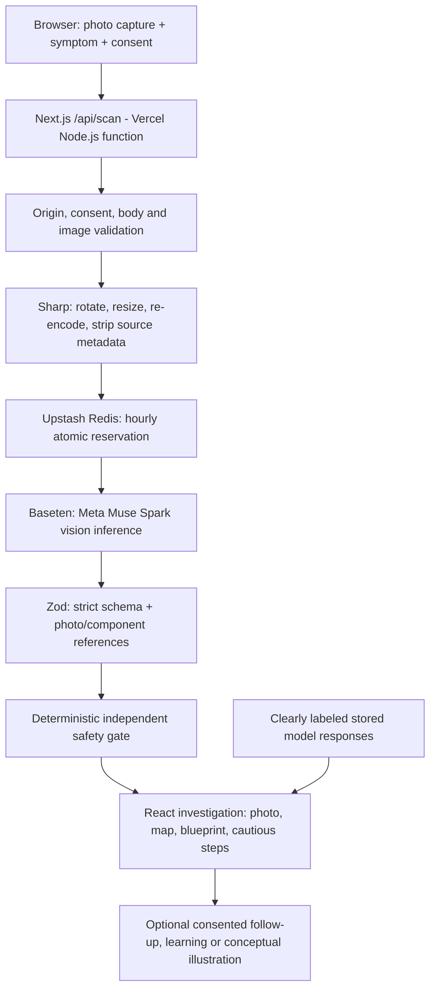

# RealityLab — architecture and execution

**Current production:** [realitylab-fix-anything.vercel.app](https://realitylab-fix-anything.vercel.app)  
**Runtime:** One Next.js repository; Vercel hosts the UI and Node.js API routes.

## Functional boundary

RealityLab is a visual analysis and cautious guidance **prototype**, not a physical repair robot or a verified diagnostic device. Its central engineering goal is to maintain traceability between an image, the model's structured hypotheses, and any suggested next step.



## One live analysis request

1. **Capture and consent** — The browser accepts up to three JPEG/PNG views (per-image maximum 5 MB) and up to 500 characters of context. It can use a device camera or a normal file picker. New inputs reset consent. No live provider call begins merely by opening a page or choosing a photo.
2. **Server input checks** — `app/api/scan/route.ts` delegates to `lib/server/scan.ts`. It validates the same-origin request, consent, file count, body size, image type and file bytes. Sharp normalizes each view, limits the longest edge and removes source metadata. Independent photos are prepared concurrently; the submitted view order is preserved.
3. **Shared quota reservation** — `lib/server/limits.ts` uses a Redis REST script to enforce one shared hourly limit across instances. Public production inference stops if required shared enforcement is unavailable. Separate per-process and request-frequency restrictions provide additional defense.
4. **One initial inference call** — `lib/server/provider.ts` sends image data URLs and a controlled system instruction to `https://inference.baseten.co/v1/chat/completions` with model `meta-models/muse-spark-open-1026`. The single-photo maximum output budget is 4,200 tokens; two- and three-photo requests have higher limits. These are ceilings, not actual output lengths.
5. **Schema and safety** — Zod validates components, connections, photo indices, evidence labels and repair fields. Then `applySafetyGate` applies a separate, conservative, pattern/risk-based decision: guided low-risk inspection, request for more evidence, or professional referral. Safety restrictions can override the model; they do not certify that the model's answer is correct.
6. **Response** — The client receives stage updates over a typed NDJSON stream and a validated result envelope. The interface prioritizes possible cause and safety, supports photo/part/diagram exploration, records user observations locally, and shows model provenance and timings.
7. **Optional features** — Follow-up review, Build & Learn, source lookup and Meta image illustrations are initiated separately by users and may consume additional inference allowance. Concept art never replaces photographic evidence.

## Key modules

| Path | Responsibility |
| --- | --- |
| `components/CapturePanel.tsx` | Browser photo upload, camera UI, consent, staged progress |
| `lib/photos.ts` | Browser image validation and safe normalization |
| `app/api/scan/route.ts` | Next.js scan endpoint |
| `lib/server/scan.ts` | Server validation, lifecycle, budget coordination, streamed result |
| `lib/server/provider.ts` | Baseten request, provider response handling and structured model output |
| `lib/analysis.ts` | Strict analysis and repair schema |
| `lib/server/orchestrator.ts` | Event sequencing, one-call budget and independent safety gate |
| `lib/server/limits.ts` | Redis reservation, local rate controls and quota reporting |
| `components/LiveResults.tsx` | Result summary and photographic/component investigation |
| `components/RepairAssessment.tsx` | Cause, risk, guided steps, verification and stop conditions |
| `app/api/component-image/route.ts` | Explicit optional concept-art generation |
| `public/demos/` | Labeled recorded inference examples and photo licenses |

## Model roles — what is real

The pipeline uses **one initial vision/reasoning model invocation**, not a swarm of independently deployed agents. FixVision, FixDiagnosis, FixSafety, FixRepair and other role labels organize the reasoning and UI. An independent code-based safety gate is real. Manual research and outcome verification are separate user-requested interactions rather than background agents completing automatically.

- **Implemented main vision model:** `meta-models/muse-spark-open-1026`, through Baseten.
- **Implemented optional image path:** server-side Meta API using configured `META_API_KEY` and `META_IMAGE_MODEL`; illustration requests are not auto-triggered.
- **Not implemented:** SAM 3.1 segmentation, general photogrammetry, exact CAD, physical testing, automated repair execution or measured diagnostic accuracy.

## Deployment configuration

Server-only variables are documented in [`.env.example`](../.env.example). Provide keys using **Vercel → Project → Settings → Environment Variables**, never in GitHub commits or client-side `NEXT_PUBLIC_*` variables.

| Setting | Purpose |
| --- | --- |
| `BASETEN_API_KEY` | Authenticates the main model provider |
| `META_API_KEY`, `META_IMAGE_MODEL` | Enable opt-in Meta-generated conceptual illustrations |
| `UPSTASH_REDIS_REST_URL`, `UPSTASH_REDIS_REST_TOKEN` | Shared hourly quota store |
| `INFERENCE_REQUESTS_PER_HOUR` | Conservative inference-request allowance |
| `DURABLE_QUOTA_REQUIRED` | Explicit requirement for durable quota enforcement |
| `PROVIDER_SPEND_CAP_VERIFIED` | Operator statement that a provider-side spending control was checked |
| `APP_ORIGIN` | Optional canonical site origin override |

**Important:** `PROVIDER_SPEND_CAP_VERIFIED` is a manual attestation and does not prove a provider-enforced hard spending ceiling. The Redis quota counts attempts, not dollars. Any actual billing limit has to be verified on the provider dashboard.

The public deployment reports non-secret readiness in [`/api/health`](https://realitylab-fix-anything.vercel.app/api/health). Its `liveVerified` field reflects only a successful scan in the current function/process lifetime and can be reset by redeployment or scaling.

## Privacy, security and resilience

- **Explicit informed consent** before photos are sent to AI providers.
- **No automatic app-server image database** or logged raw images; stored recorded examples are explicitly identified.
- **Project export is local**; photos are excluded by default unless the user chooses otherwise.
- **Bounded** images, payloads, concurrent requests and output sizes; cancellation and timeouts propagate where practical. Cancellation cannot undo provider charges already incurred.
- **Strict no-substitution rule:** failed or incomplete live requests produce recoverable errors; the app does not serve a stored inference as if it were new.
- **Production quota** is shared through Redis; the HTTP status and UI may show rate limits after other visitors consume the same allowance.
- **Accessibility controls** include keyboard/focus behavior, reduced-motion support, high-contrast responses and camera fallback, tested in automated suites; complete assistive-technology and physical-device validation is outstanding.

## Performance note

One previously observed live scan took **17.84 seconds** server-side, with **17.43 seconds** attributable to provider inference. Current optimizations include concurrent multi-image preparation, a lower single-view output ceiling and concise model instructions. **Sub-10-second execution is an aspiration, not a verified service guarantee.** External-model queueing, content length and provider latency remain major determinants.

## Reproducibility

```bash
npm ci
npm run build && npm run typecheck
npm test
npm run test:scan-http
npm run eval:recorded
```

All ordinary CI tests run using mocked or archived model outputs. Explicit live tests may consume credits. See [the README](../README.md) and [judge's guide](JUDGE_GUIDE.md) for a walkthrough and fair evaluation boundaries.